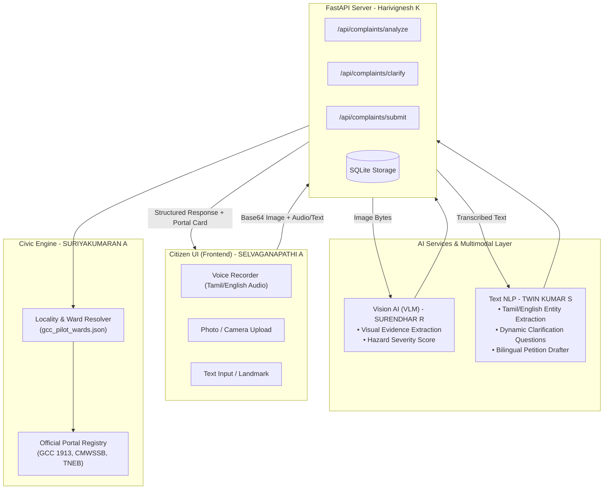

# OorNalam AI (ஊர்நலம்) — Project Idea & 24-Hour Implementation Plan

> **Hackathon:** Aarvam — Cybernaut Hackathon 2026  
> **Problem Statement:** ARSW001 — *Our Town, Reimagined: Smart Community Hack*  
> **Team Name:** Byte Breakers  
> **Team ID:** AARVAM-S-0004  
> **Division:** Software Division  
> **Tagline:** *“A Better Town Begins with Your Voice.”*  
> **Date:** October 31 – November 1, 2026  

---

## 1. Executive Summary & Core Idea

### The Problem in Tamil Nadu
Across Tamil Nadu's **25 municipal corporations, 148 municipalities, and 490 town panchayats**, civic redressal systems (like Greater Chennai Corporation 1913, CMWSSB, and CMDA) exist, but citizens encounter severe friction:
1. **Departmental Maze & Jurisdictional Confusion:** Citizens do not know whether a broken road belongs to the Corporation, State Highways, or PWD. Filing with the wrong department leads to weeks of inter-departmental transfers and eventual rejection.
2. **Vernacular & Digital Divide:** Elderly and vernacular residents express grievances with vivid detail and emotion in **spoken Tamil**, but struggle with formal bureaucratic English or complex typed online forms.
3. **Unstructured & Ambiguous Evidence:** Photos uploaded without location landmarks, timestamps, or severity context leave ward engineers unable to prioritize or verify the hazard.
4. **Bureaucratic Drop-Off:** Frustrated citizens give up before complaints are filed, leading to recurring civic hazards.

### The Solution: OorNalam AI (ஊர்நலம்)
**OorNalam AI** is an intelligent, multimodal civic copilot. It acts as an **AI-powered pre-filing intelligence layer** that:
- Accepts **voice audio in Tamil or English**, typed text, and photo uploads.
- Uses **Vision AI (VLM)** to extract objective visual evidence (garbage volume, pothole depth, waterlogging level) without hallucinating facts.
- Runs an **Intelligent Clarification Loop** to proactively ask targeted follow-up questions when critical details (e.g., landmark or ward) are missing.
- Employs a **Locality-Aware Routing Engine** to resolve exact jurisdictional responsibility (e.g., GCC Bus Route Roads vs. CMWSSB Drainage).
- Synthesizes a **Bilingual Formal Grievance Letter** ready for instant copy-pasting or automated dispatch to official Tamil Nadu government portals.

> [!IMPORTANT]
> **Core Architectural Stance: Pre-Filing Intelligence, Not Portal Replacement**  
> OorNalam does not claim to replace sovereign government portals. Instead, it prepares, structures, and validates the citizen's case upfront so that municipal engineers receive actionable, properly routed complaints on day one.
>
> **Killer Differentiator: Adaptive Grievance Completeness Engine (AGCE)**  
> Instead of a static form with 15 bureaucratic questions, AGCE dynamically evaluates 5 critical dimensions:
> 1. *What is already available?* (Audio transcript, image metadata, GPS)
> 2. *What can be inferred reliably?* (VLM physical hazards, severity, day/night)
> 3. *What needs citizen confirmation?* (1 high-stakes query: e.g. "Sewage entering homes?")
> 4. *What is mandatory for the selected portal?* (CMWSSB vs TANGEDCO vs GCC SWM rules)
> 5. *Is the complaint sufficiently clear to file?* (Dynamic Completeness Score: 0-100%)
> The citizen experiences a 15-second natural conversation, not a government form.

---

## 2. System Architecture & Multimodal Pipeline



---

## 3. Team Responsibilities & Ownership Matrix

| Member | Role | Engineering Scope | Dedicated Directory | Primary Tools |
| :--- | :--- | :--- | :--- | :--- |
| **SURIYAKUMARAN A** *(Leader)* | **Role E** | **Routing Engine, Portal Verification, QA & Project Lead** | `routing_data/` & Root | Python, Pytest, Pitch Deck |
| **SELVAGANAPATHI A** | **Role A** | **Frontend & Citizen Experience Developer** | `frontend/` | React, Vite, TypeScript, Tailwind, Lucide |
| **Harivignesh K** | **Role B** | **Backend & Database Architecture Developer** | `backend/` | FastAPI, Pydantic, SQLite, Uvicorn |
| **TWIN KUMAR S** | **Role C** | **Text AI & NLP Developer** | `ai_services/` | Python, LLM APIs, Prompt Engineering |
| **SURENDHAR R** | **Role D** | **Vision AI & Multimodal Developer** | `vision_ai/` | Gemini VLM, Image Analysis, Severity Scoring |

---

## 4. Contract-First Development (`shared/contracts.json`)

To prevent bottlenecks, all five developers adhere strictly to the shared API contract:

### A. Intake Analysis: `POST /api/complaints/analyze`
```json
{
  "text_content": "Street light broken and water leaking near Anna Nagar roundabout",
  "voice_transcript": "அண்ணா நகர் ரவுண்டானா பக்கத்துல பைப் உடைஞ்சு தண்ணி வீணாகுது...",
  "image_base64": "data:image/jpeg;base64,...",
  "language_preference": "ta"
}
```

### B. Response Structure:
```json
{
  "complaint_id": "c9a4f210-9051-4f1a-b68a-6f0a359214b7",
  "detected_category": "waterlogging_drainage",
  "category_confidence": 0.94,
  "visible_evidence": ["drinking_water_pipe_burst", "flowing_water", "road_pavement_submerged"],
  "extracted_details": {
    "landmark": "Anna Nagar Roundabout",
    "ward": "Ward 102 (Zone 8 - Anna Nagar)",
    "duration": "2 days"
  },
  "follow_up_questions": [
    {
      "id": "confirm_pipe_type",
      "question_en": "Is this drinking water leakage or underground sewage overflow?",
      "question_ta": "இது குடிநீர் குழாய் கசிவா அல்லது கழிவுநீர் தேக்கமா?"
    }
  ],
  "routing": {
    "target_department": "Chennai Metro Water (CMWSSB)",
    "official_portal": "https://cmwssb.tn.gov.in/complaints",
    "helpline": "044-45674567 / 1916",
    "expected_sla_hours": 24
  }
}
```

---

## 5. 24-Hour Hour-by-Hour Implementation Schedule

```mermaid
gantt
    title Byte Breakers 24-Hour Hackathon Timeline
    dateFormat X
    axisFormat Hour %H

    section Setup & Contract
    Requirements, Schemas & Branching (All)     :done, 0, 2
    section Decoupled Build
    Frontend UI & Bilingual Forms (Selvaganapathi) :active, 2, 8
    Backend FastAPI & SQLite CRUD (Harivignesh)   :active, 2, 8
    Vision AI Evidence Extractor (Surendhar)       :active, 4, 10
    Text AI & Tamil Grievance Drafter (Twin Kumar):active, 4, 10
    Locality & Ward Routing Engine (Suriyakumaran):active, 6, 12
    section Integration
    API & Model Wiring (Harivignesh + AI team)    :12, 16
    Frontend Switch to Live Backend (All)         :16, 18
    section Testing & Polish
    End-to-End Edge Case Testing & Fixes (All)    :18, 21
    Pitch Deck & Demo Video Dry Run (All)         :21, 24
```



### Detailed Breakdown

* **Hours 0–2 (Setup & Architecture):**
  - Verify repo clones and branch checkouts across all 5 laptops.
  - Review `shared/contracts.json`.
  - Frontend runs with `src/api/mock.ts` enabled (`USE_MOCK = true`).

* **Hours 2–6 (Independent Component Construction):**
  - **Selvaganapathi:** Build mobile-responsive citizen intake card, voice recording button with mic pulse animation, and Tamil/English toggle.
  - **Harivignesh:** Scaffold FastAPI app, SQLite database tables, and Pydantic validation schemas.
  - **Twin Kumar:** Implement zero-shot prompt templates for Tamil speech intent parsing and complaint classification.
  - **Surendhar:** Set up Gemini VLM image prompt for objective civic hazard identification.
  - **Suriyakumaran:** Build Ward-to-Department mapping database for Greater Chennai Corporation (GCC) and Tamil Nadu municipal bodies.

* **Hours 6–10 (Service Maturation):**
  - **Twin Kumar:** Build clarification generator for incomplete inputs (e.g., missing street or ward number).
  - **Surendhar:** Add severity scoring (`Low`, `Medium`, `Severe/Immediate Danger`) based on visual cues (e.g., water depth, pedestrian obstruction).
  - **Harivignesh:** Implement complaint lifecycle endpoints (`/analyze`, `/clarify`, `/submit`, `/track`).
  - **Selvaganapathi:** Build the interactive Clarification Chat UI and Draft Grievance Preview modal.

* **Hours 10–14 (Pre-Integration Verification):**
  - Unit test `ai_services` and `vision_ai` standalone scripts.
  - Run `routing_data/test_e2e_scenarios.py` to ensure zero routing misclassifications.
  - Harivignesh wires `ai_services` and `vision_ai` into `backend/app/routers/complaints.py`.

* **Hours 14–18 (Full Integration):**
  - Connect Frontend to Backend: set `USE_MOCK = false` in `frontend/src/api/mock.ts`.
  - Test real HTTP calls between Vite dev server (`:5173`) and FastAPI (`:8000`).
  - Resolve CORS, JSON serialization, and image base64 parsing issues.

* **Hours 18–21 (QA, Edge Cases & Robustness):**
  - Test noisy audio inputs (ambient traffic background).
  - Test ambiguous photos (blurry roads, night photos).
  - Test network drop fallbacks: ensure local caching preserves user drafts.

* **Hours 21–24 (Pitch Deck Rehearsal & Live Demo Polish):**
  - Rehearse the 3-minute pitch using `OorNalam_Hackathon_Pitch.pptx`.
  - Prepare 3 foolproof, pre-tested demo scenarios on disk as fallback.
  - Dry run Q&A for jury questions (data privacy, hallucination prevention, municipal scalability).

---

## 6. Live Demo Scenarios for Judges

### Scenario 1: The Spoken Tamil Report (Solid Waste)
* **Input:** Tamil voice recording: *"ரெண்டு நாளா இந்த குப்பைத் தொட்டி நிரம்பி வழியுது, பக்கத்துல பள்ளிவாசல் இருக்கு, உடனே சுத்தம் செய்யணும்."*
* **AI Action:** Transcribes Tamil audio -> extracts landmark (Mosque) -> detects waste accumulation -> calculates urgency.
* **Result:** Generates formal GCC Solid Waste Management (SWM) petition in Tamil & English; direct CTA button to GCC 1913 portal.

### Scenario 2: Dangerous Rain Pothole (Multimodal Vision + Voice)
* **Input:** Photo of an open, waterlogged pothole on a bus route road + English voice caption: *"Huge crater on Arcot Road near Vadapalani junction, two bikes slipped today."*
* **AI Action:** VLM flags `hazard_severity: High`, detects risk to two-wheelers, matches Arcot Road to GCC Bus Route Roads Dept.
* **Result:** Formats prioritized safety alert with photographic evidence markers ready for municipal engineers.

### Scenario 3: Ambiguous Report Triggering Clarification
* **Input:** Citizen says: *"Water is stagnant in our street."* (No photo, no locality provided).
* **AI Action:** AI detects missing landmark and category ambiguity (drinking water vs. drainage).
* **Result:** System prompts the user: *"Please specify your street/ward, and whether this is clean pipe water or sewer drainage."*

---

## 7. Git & Team Collaboration Rules

1. **Never commit directly to `main`:** All work stays on feature branches until integration.
2. **Pull frequently:** Run `git fetch origin && git rebase origin/main` to stay updated.
3. **Keep branches clean:**
   - Frontend changes $\rightarrow$ only touch `frontend/`
   - Backend changes $\rightarrow$ only touch `backend/`
   - AI changes $\rightarrow$ only touch `ai_services/` or `vision_ai/`
   - Routing changes $\rightarrow$ only touch `routing_data/`
4. **Integration Order (Hour 14):**
   1. Merge `feat/backend-api`
   2. Merge `feat/text-nlp` and `feat/vision-vlm`
   3. Merge `feat/routing-lead`
   4. Merge `feat/frontend-ui`
   5. Run full end-to-end verification tests.
