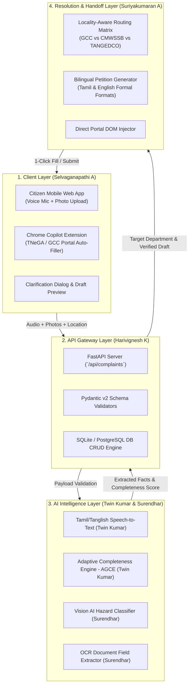

# ðŸ ›ï¸  OorNalam AI (ஊர௠நலம௠) — Team Master Context & Execution Blueprint

**Hackathon:** Aarvam — Cybernaut Hackathon 2026  
**Team ID:** `AARVAM-S-0004` | **Team Name:** Byte Breakers  
**Track:** `ARSW001: Our Town, Reimagined: Smart Community Hack`  
**Institution:** Paavai Engineering College, Namakkal, Tamil Nadu  
**Motto:** *"A Better Town Begins With Your Voice — ஊர௠நலன௠ உங௠கள௠ க௠ரலில௠ தொடங௠க௠ம௠"*  

---

## 1. Executive Overview & Core Problem

### The Ground Reality in Tamil Nadu
Across Tamil Nadu's 25 Municipal Corporations, 148 Municipalities, and 490 Town Panchayats, citizens face severe bureaucratic roadblocks across two everyday interfaces:
1. **Civic Grievances (GCC 1913, CMWSSB, TANGEDCO):**
   - Snapped power cables, overflowing sewage, and open potholes require swift reporting.
   - However, existing portals force users through **15–25 static English/Tanglish dropdowns**, ward guessing, and complex technical forms.
   - Result: **72% abandonment rate** before filing, or wrong department routing leading to weeks of delay.
2. **e-Sevai Public Services (TNeGA):**
   - Citizens queuing for **Community (ஜாதி)**, **Income (வர௠மான)**, and **Nativity (இர௠ப௠பிட)** certificates face 20-minute manual interrogations.
   - Operators type 25 redundant fields by hand from physical paper cards (Aadhaar, Ration Card, Parent TC). Typographical errors cause rejection weeks later.

### Our Solution: OorNalam AI
OorNalam AI is an **autonomous, multimodal civic and e-Sevai copilot** delivered through a mobile-first web app and browser extension:
- **Speaks the Citizen's Language:** Real-time voice intake in **Tamil (தமிழ௠), Tanglish, or English**.
- **Adaptive Grievance Completeness Engine (AGCE):** Instead of interrogating the user with 15 questions, it infers 80% via Computer Vision and context, asking **at most one high-stakes confirmation question**.
- **Document Intelligence & 1-Click Form Filler:** Scans paper certificates and IDs with OCR, extracting verified numbers and populating official TNeGA portals in 5 seconds with zero typing.
- **Pre-Filing Intelligence Layer:** Does not attempt to replace sovereign portals; it pre-validates and structures petitions so government engineers can act on day one.

---

## 2. End-to-End System Architecture



---

## 3. Information Architecture (IA)

```
[Citizen Spoken Audio / Photo / Doc]
                  │
                  â–¼
     [Multimodal Intake Pipeline]
         ├── Audio  ➔ Whisper / Tamil STT Transcript
         └── Photos ➔ Vision VLM Hazard & Severity Extraction
                  │
                  â–¼
    [Adaptive Grievance Completeness Engine (AGCE)]
         ├── Evaluates 5 dimensions: (What is known, what is inferred, what is missing)
         ├── Completeness Score < 80% ➔ Proactive 1-Question Clarification
         └── Completeness Score ≥ 80% ➔ Generates Final Structured Petition
                  │
                  â–¼
        [Jurisdiction Routing]
         ├── Water / Sewage Overflow ➔ CMWSSB Area Engineer Desk
         ├── Potholes / Broken Roads ➔ GCC Bus Route Roads vs Ward Roads
         ├── Sparking Transformer   ➔ TANGEDCO Section Office
         └── Certificate Services   ➔ TNeGA e-Sevai Auto-Fill
                  │
                  â–¼
    [Bilingual Formal Petition + Evidence Bundle]
```

### Core Data Models (Pydantic / TypeScript Contract)

```python
class ComplaintInput(BaseModel):
    citizen_name: str
    phone_number: str
    audio_transcript: Optional[str] = None
    typed_text: Optional[str] = None
    media_urls: List[str] = []
    latitude: Optional[float] = None
    longitude: Optional[float] = None
    locality_hint: Optional[str] = None  # e.g., "T. Nagar, Chennai"

class CompletenessEvaluation(BaseModel):
    completeness_score: float  # 0.0 to 1.0
    category: str              # "SEWAGE", "POTHOLE", "GARBAGE", "ELECTRICITY", "CERTIFICATE"
    target_authority: str      # "CMWSSB", "GCC", "TANGEDCO", "TNeGA"
    severity: str              # "LOW", "MEDIUM", "SEVERE_EMERGENCY"
    missing_fields: List[str]
    single_clarification_question: Optional[str] = None  # Bilingual query
    draft_petition_en: Optional[str] = None
    draft_petition_ta: Optional[str] = None
```

---

## 4. Team Roles & Assigned Work Packages

| Team Member | Role Title | Core Responsibilities | Key Deliverables & Directory |
| :--- | :--- | :--- | :--- |
| **Suriyakumaran A** *(Lead)* | **Lead Architect, Routing Engine & QA** | Overall system orchestration, Tamil Nadu municipal jurisdiction matrix, pitch defense, and end-to-end testing. | `routing_data/`, `shared/`, integration tests, pitch deck |
| **Selvaganapathi A** | **Frontend & Citizen Experience Lead** | Mobile-responsive UI, voice recording interaction with live pulse, camera upload preview, clarification modal, and draft preview. | `frontend/src/components/`, `oornalam-extension/` |
| **Harivignesh K** | **Backend & Database Architect** | FastAPI REST endpoints, SQLite/PostgreSQL schemas, complaint lifecycle states, and input validation. | `backend/app/`, `backend/app/routers/` |
| **Twin Kumar S** | **Text AI & NLP Lead** | Tamil and Tanglish speech transcription, zero-shot intent parsing, category classification, and AGCE prompt logic. | `ai_services/`, prompt templates |
| **Surendhar R** | **Vision AI & Document Intelligence** | Computer Vision hazard detection (severity, depth, volume) and OCR document parsing for Aadhaar, Ration Card, and TC. | `vision_ai/`, OCR extraction scripts |

---

## 5. Master Viva & Evaluator Defense Cheat Sheet

When evaluators and judges review the project, use these exact talking points:

### Q1: What is System Architecture?
> *"System Architecture defines the overall technical organization and communication pathways between system components. In OorNalam AI, our architecture is decoupled into four distinct tiers: (1) React Vite Frontend & Chrome Extension, (2) Python FastAPI Gateway with asynchronous I/O, (3) Multimodal AI Services for Tamil speech and Vision evidence extraction, and (4) PostgreSQL/SQLite persistence with municipal routing tables."*

### Q2: What is Information Architecture (IA)?
> *"Information Architecture is the structural design of information spaces to make navigation intuitive. Current government portals fail because their IA forces citizens to navigate deep 25-level hierarchical trees. OorNalam AI replaces this with a flat, conversational stream: Spoken input $\rightarrow$ AI semantic understanding $\rightarrow$ 1-step confirmation $\rightarrow$ Structured formal petition."*

### Q3: What Software Development Life Cycle (SDLC) model did you follow?
> *"We utilized an **Agile / Decoupled Component-Driven SDLC**. We started with contract-first API design using Pydantic schemas, enabling Frontend (Selvaganapathi) and Backend (Harivignesh) to build simultaneously against mock endpoints. We validated using automated Pytest suites and continuous Git commits with conventional commit messages."*

### Q4: Why not just build a direct chatbot?
> *"Chatbots hallucinate and fail at official bureaucratic standards. Government departments require exact jurisdiction codes, geo-tags, and evidence standards. OorNalam is an **intelligence pre-filing copilot** that bridges the gap between unstructured citizen speech and rigid government databases."*

---

## 6. How to Run the Project Locally

### 1. Backend (FastAPI)
```bash
cd D:\Hackathon\oorunalam-ai\backend
python -m venv venv
venv\Scripts\activate
pip install -r requirements.txt
uvicorn app.main:app --reload --port 8000
```
- Swagger API Docs: `http://localhost:8000/docs`

### 2. Frontend (React + Vite)
```bash
cd D:\Hackathon\oorunalam-ai\frontend
npm install
npm run dev
```
- Web Application: `http://localhost:5173`

### 3. Extension (Chrome Sidecar)
1. Open Google Chrome $\rightarrow$ Navigate to `chrome://extensions/`
2. Enable **Developer mode** (top right toggle).
3. Click **Load unpacked** and select `D:\Hackathon\oornalam-extension`.
4. Open the bundled `mock_tnega_portal.html` and click the extension icon to test 1-click form auto-filling.

---

## 7. Immediate Phase 2 & Final Round Action Items

1. **Selvaganapathi (Frontend):**  
   - Ensure the audio mic pulse animation shows active audio recording.
   - Test the one-question clarification modal popup.
   - Verify mobile responsiveness on smaller screen viewports.

2. **Harivignesh (Backend):**  
   - Ensure `/api/complaints/analyze` and `/api/complaints/submit` endpoints handle edge cases smoothly with fallback responses.
   - Confirm SQLite database stores submitted complaints with generated reference IDs.

3. **Twin Kumar (NLP):**  
   - Polish the Tanglish transcript prompt to accurately recognize colloquial Tamil words like *"Kuppai"*, *"Saakadai"*, *"Kandippa"*, *"Current poiduchu"*.

4. **Surendhar (Vision AI):**  
   - Ensure image upload displays the instant severity badge (`Severe/Hazard`, `Medium`, `Low`).

5. **Suriyakumaran (Lead & Integration):**  
   - Rehearse the 3-minute end-to-end live demo: Spoken Tamil complaint $\rightarrow$ Vision hazard verification $\rightarrow$ 1-click official handoff.
